# Agentic Platform: Architecture and Contracts

This is a Rust implementation of the platform described in InfoQ's
["Platform Engineering Playbook for Production LLMs"](https://www.infoq.com/articles/platform-engineering-playbook-production-llms/).
It uses tokio, axum, rig 0.43, fastmcp-rust 0.11 and docker-compose.

The framework is generic. An agentic project brings three things:
- a config directory (platform, users, intents, policies, prompts),
- its typed specialist output schemas, registered in a short `main.rs`,
- one or more fastmcp-rust tool servers.

### System overview



## 1. Mapping from the article

| Article concept | Here |
|---|---|
| Single gateway ingress, role-bearing JWTs | `agentic-platform::gateway` (axum), `agentic-core::auth` (jsonwebtoken, HS256) |
| Root coordinator (ADK) | `agentic-platform::coordinator`: intent gate first, optional LLM fallback |
| Intent validation gate (YAML keyword rules, "unclassified" instead of best guess) | `agentic-platform::intent` |
| Specialist agents with registry prompt + output schema | `Specialist<T: AgentOutput>` run through the `AgentEngine` seam (rig `AgentBuilder` by default) |
| Prompt registry, versions, live pointer, rollback | `agentic-platform::prompts` (YAML files + persisted live-pointer state) |
| Schema enforcement at the platform boundary, failure-classified retries | `agentic-platform::guard` |
| MCP servers per team, FastMCP, AuthzMiddleware default-deny | `mcp/agentic-mcp` (fastmcp-rust `AuthProvider` + `Middleware`), `agentic-core::policy` |
| LiteLLM model seam | `provider:model` specs resolved per engine (`agentic-platform::llm`); optionally `gateway:<alias>` through a shared AI gateway such as the LiteLLM Proxy (section 13) |
| Behavioural observability, `UserMetrics`, cost attribution | `agentic-platform::telemetry` (Prometheus `/metrics`, in-memory per-user store, tracing) |
| Golden-set evaluation, trajectory score >= 0.8 | `agentic-eval` CLI (CI gate, non-zero exit on fail) |
| Per-tenant rate limiting | `agentic-platform::gateway::rate_limit` (per-team token bucket; a second per-client-IP bucket guards `POST /auth/token`) |

## 2. Repository layout (two Cargo workspaces)

```
rust-platform/
  rust-toolchain.toml          # nightly pinned; fastmcp-rust needs rust-version 1.100
  Cargo.toml                   # workspace A (tokio). exclude = ["mcp", "examples/a2a-mesh/ops-agent"]
  crates/
    agentic-core/              # runtime-agnostic: claims, JWT, policy, tags, MCP wire constants. Used by BOTH workspaces (path dep)
    agentic-platform/          # tokio framework: gateway, intent, coordinator, prompts, guard, llm, mcp client, telemetry
    agentic-eval/              # golden-set evaluator CLI (talks to a running gateway over HTTP)
  examples/
    docs-assistant/            # the article's example: docs_agent + tickets_agent
      src/main.rs              # gateway binary
      config/                  # platform.yaml, users.yaml, intents.yaml, policies.yaml, prompts/*.yaml
      eval/golden.json, eval/eval.yaml
    minimal/                   # copy-me template: one specialist, one MCP server
    a2a-mesh/                  # A2A demo: mesh-gateway (workspace A), ops-agent (own workspace, adk-rust), compose, README
  mcp/
    Cargo.toml                 # workspace B (asupersync runtime, fastmcp-rust)
    agentic-mcp/               # fastmcp helpers: JWT AuthProvider, policy Middleware, env config, run()
    servers/
      docs-mcp/                # search_docs, get_doc over an embedded markdown corpus
      tickets-mcp/             # list_tickets, get_ticket, create_ticket (in-memory store)
      calc-mcp/                # add, multiply (minimal example)
  deploy/                      # Dockerfile, prometheus, grafana provisioning
  docker-compose.yml           # docs-assistant stack
  docs/ARCHITECTURE.md
```


Dashed edges are optional cargo features. `agentic-eval` has no platform dependency; it scores any gateway over HTTP. `ops-agent` deliberately shares no crate with the platform: it stands in for another team's agent and interoperates only through A2A.

**Why two workspaces?** fastmcp-rust pins `serde_json` with `arbitrary_precision`. Cargo feature unification would leak that feature into rig/axum, and it breaks untagged/flattened serde of numbers. fastmcp-rust also requires the asupersync runtime; it does not run on tokio. Workspace B therefore never builds tokio-side crates. `agentic-core` must not depend on tokio, axum, rig, or fastmcp. Its only dependencies are serde, serde_json, serde_yaml, jsonwebtoken, thiserror, chrono, and glob matching.

## 3. Request flow


The guard's attempt loop, per failure class:


Tokens and audiences: one identity, narrowed at each hop.


Step by step:

```
client --POST /auth/token {api_key}--> gateway --> JWT {sub, team, roles, iss, aud:"gateway", exp}
client --POST /v1/agents/run (Bearer JWT)-->
  gateway: verify JWT -> RequestContext{request_id, user, team, roles, application, use_case}
         -> per-team rate limit
         -> intent gate (keyword rules)  --unclassified--> [routing.unclassified = reject -> 422 | llm -> coordinator LLM picks agent or none -> 422]
         -> specialist: resolve LIVE prompt from registry (id, version, template, model?, temperature?)
         -> guard loop (max_attempts, token budget):
              build engine turn per request (rig by default): preamble = template + output-schema instructions
                 tools = MCP tools of the specialist's servers, wrapped as engine-neutral ToolSpecs that
                         call the MCP server with a DELEGATED JWT {aud:"mcp", sub, team, roles, request_id, exp<=60s}
                         and record each call into the run's Evidence (trajectory + results)
              run (max_turns) -> text + usage
              parse JSON -> validate against schemars schema -> T::validate(&evidence)
              classify outcome: Ok | SchemaViolation(msg) -> re-prompt with error
                                   | Hallucination(msg) -> re-prompt with grounding reminder + evidence summary
                                   | MaxTurns -> re-prompt without backoff: "stop calling tools, answer now" + evidence summary
                                   | Infra(err) -> exponential backoff, same prompt
         -> telemetry: per-request record (tokens, cost from pricing table, latency, outcome, hallucination, tool calls)
  <-- RunResponse
MCP server (fastmcp-rust): AuthProvider verifies delegated JWT (sig, iss, aud="mcp", exp) -> AuthContext{subject, scopes=roles, claims}
                           Middleware on tools/call: policy.check(roles, "<server>.<tool>") default-deny -> denial reaches client as detectable error
```

## 4. Wire contracts (gateway HTTP API)

Every error body is `{"error": {"code": "<snake_case>", "message": "..."}, "request_id": "..."}`.

- `GET /healthz` -> `{"status":"ok"}`
- `GET /metrics` -> Prometheus text. Served on the main listener unless `metrics_listen` is set, in which case only that listener serves it and the main router answers 404.
- `POST /auth/token` `{"api_key": "..."}` -> `{"access_token","token_type":"Bearer","expires_in"}`. Unknown key -> 401. Throttled per client IP (peer address from `ConnectInfo`; `X-Forwarded-For` is never read, so behind a proxy every client shares the proxy's bucket): 429 `rate_limited` beyond `rate_limit.auth_rate_limit_per_minute` (default 10, 0 disables). Without `ConnectInfo` (in-process tests) all callers share one bucket.
- `GET /v1/agents` (auth) -> `[{"name","description","prompt_id","mcp_servers":[...]}]`
- `POST /v1/agents/run` (auth) `{"input": "...", "application"?: "...", "use_case"?: "..."}`
  - Default tags: `application` = platform `app`; `use_case` = chosen agent name.
  - Optional header `x-application` / `x-use-case` override too; body wins.
  - Both are metric labels, so an explicit value is validated before anything is recorded: `application` must be in the `applications:` allowlist (default `[app]`), `use_case` must match `^[a-z0-9][a-z0-9_.-]{0,63}$` and be in the `use_cases:` allowlist (default: the registered specialist names). Otherwise 400 `invalid_request`.
  - Response 200:
    ```json
    {
      "request_id": "uuid",
      "agent": "docs_agent",
      "prompt": {"id": "docs_agent", "version": "2.0.0"},
      "output": { ...typed specialist output... },
      "trace": {
        "classification": {"method": "keywords|llm", "scores": {"docs_agent": 4, "tickets_agent": 0}},
        "engine": "rig",
        "attempts": [{"attempt": 1, "outcome": "schema_violation|hallucination|max_turns|infra_error|ok", "detail": "..."}],
        "tool_calls": [{"server": "docs", "tool": "search_docs", "outcome": "ok|error|denied", "latency_ms": 12}],
        "usage": {"input_tokens": 0, "output_tokens": 0, "cost_usd": 0.0},
        "latency_ms": 1234
      }
    }
    ```
  - 422 `unclassified` (intent gate and fallback both declined); the body carries `trace.classification.scores`. 400 `invalid_request` for malformed bodies or empty `input`. A `rate_limit.requests_per_minute_per_team` of 0 disables limiting.
  - 429 `rate_limited`. 502 `agent_failed` once the retry budget is exhausted; the body still carries `trace`. 500 `internal` when the routed agent, its live prompt or its model cannot be resolved.
- `GET /v1/metrics/me` (auth) -> `UserMetrics {user_id, team, requests, successes, errors, hallucinations, schema_violations, input_tokens, output_tokens, cost_usd, avg_latency_ms}`
- `GET /v1/metrics/teams` (role `admin`) -> `[TeamMetrics {team, application, use_case, requests, input_tokens, output_tokens, cost_usd}]`
- `GET /admin/prompts` (admin) -> `[{"id","live","versions":[{"version","created_at","tags"}]}]`
- `GET /admin/prompts/{id}` (admin) -> full prompt record including templates
- `POST /admin/prompts/{id}/live` (admin) `{"version":"1.0.0","record_history"?:true}` -> moves the live pointer (no redeploy). With `record_history: false` the previous version is not pushed onto the rollback history; `agentic-eval --set-live` uses this for both the override and the restore, so evaluation runs leave `rollback` untouched.
- `POST /admin/prompts/{id}/rollback` (admin) -> moves live to the previous pointer in the history; 409 if there is none

## 5. Config formats (all YAML, `${VAR}` / `${VAR:-default}` env interpolation applied to platform.yaml)

`platform.yaml`
```yaml
app: docs-assistant
listen: ${LISTEN_ADDR:-0.0.0.0:8080}
auth:
  jwt_secret_env: PLATFORM_JWT_SECRET   # env var name holding the HS256 secret
  issuer: agentic-platform
  token_ttl_secs: 3600
  delegated_ttl_secs: 60
users_file: users.yaml          # paths relative to this file
intents_file: intents.yaml
policies_file: policies.yaml
prompts_dir: prompts
prompt_state_file: ${PROMPT_STATE_FILE:-./data/prompt-state.json}
engine: ${AGENT_ENGINE:-rig}   # agent engine: `rig`, or `adk` when built with the `adk` cargo feature. Unknown names fail the build and list the registered engines
models:                         # spec `<provider>:<model>`; `gateway:<alias>` routes through llm_gateway
  default: ${DEFAULT_MODEL:-ollama:gpt-oss}
  coordinator: ${COORDINATOR_MODEL:-ollama:gpt-oss}
# Optional OpenAI-compatible AI gateway (LiteLLM Proxy reference; Portkey, Kong, Envoy AI Gateway also fit).
# Inert unless a `gateway:<alias>` spec is used. Both engines call `<url>/chat/completions` (never the Responses API).
llm_gateway:
  url: ${LLM_GATEWAY_URL:-http://localhost:4000}   # a bare host gets `/v1` appended; a URL with a path (`/v1`, `/openai/v1`) is used as given, minus trailing slashes
  api_key_env: LLM_GATEWAY_API_KEY                 # env var holding the default virtual key (default name)
  team_keys: {docs-team: LLM_GATEWAY_KEY_DOCS_TEAM}   # optional; team -> env var of that team's key. An unset team key warns and falls back to the default key
  send_metadata: true                              # default true; send `user` + `metadata` (rig engine only)
  timeout_secs: 120                                # default 120; rig engine only
pricing:                        # USD per 1M tokens, keyed by model spec
  "ollama:gpt-oss": {input: 0.0, output: 0.0}
  "gateway:default": {input: 0.0, output: 0.0}   # the caller's estimate for the alias; the gateway's spend log is authoritative when the alias's backing model changes
  "openai:gpt-4.1-mini": {input: 0.40, output: 1.60}
guard: {max_attempts: 3, max_total_tokens: 60000, backoff_base_ms: 250}
rate_limit: {requests_per_minute_per_team: 60, auth_rate_limit_per_minute: 10}   # 0 disables either
applications: [docs-assistant]  # optional; accepted caller-supplied `application` values, default [app]
use_cases: [docs_agent, tickets_agent]   # optional; accepted `use_case` values, default = registered specialist names
# metrics_listen: 0.0.0.0:9100  # optional; when set, /metrics is served only here
routing: {unclassified: llm}    # reject | llm
tool_visibility: all            # filtered (hide tools the caller's roles cannot call) | all (let MCP servers enforce)
mcp_servers:
  docs: {url: "${DOCS_MCP_URL:-http://localhost:3001/mcp}"}
  tickets: {url: "${TICKETS_MCP_URL:-http://localhost:3002/mcp}"}
# Optional, needs the `a2a` cargo feature (section 12):
remote_agents:                  # model spec `a2a:<name>` for specialists on engine `a2a`
  ops: {url: "http://ops:8090", audience: "a2a:ops", auth: delegated, timeout_secs: 120, skill: ops_triage, delegate_roles: [reader]}   # all but url optional; audience defaults to `a2a` and may not be `gateway`, `mcp` or empty; delegate_roles defaults to the caller's roles minus admin and platform
a2a:
  server: {enabled: false, path: /a2a, public_url: "http://localhost:8080/a2a", accept_audiences: [gateway, a2a, "a2a:docs-assistant"], task_ttl_secs: 900}   # accept_audiences defaults to [gateway, a2a, a2a:<app>]; task_ttl_secs defaults to 900
```

`gateway:<alias>` resolves to the OpenAI-compatible chat client with base URL `llm_gateway.url` and the caller's team key (else the default key); models are cached per (alias, key). A missing default key fails `build()` only when a `gateway:` spec is in use (default or coordinator model), and a `gateway:` spec without an `llm_gateway` block fails with "model spec `gateway:x` needs an `llm_gateway` block in platform.yaml". Prompt-level `model: gateway:...` overrides fail the request at resolution time instead. On a `gateway:` spec with `send_metadata`, the rig engine adds `user` (the caller's `sub`) and `metadata` (`team`, `application`, `use_case`, `agent`, `prompt_version`, `request_id`, `tags: [team:.., app:.., agent:..]`, plus the same fields under `spend_logs_metadata`, which is the key LiteLLM persists) to the request body; the coordinator's calls carry `agent: coordinator`. Direct specs never receive these fields.

`users.yaml`. These are demo identities with well-known default keys, each overridable through its `*_API_KEY` env var; a real deployment swaps in OIDC behind the same `Claims`.
```yaml
users:
  - {id: alice, api_key: "${ALICE_API_KEY:-alice-key}", team: docs-team, roles: [reader]}
```

`intents.yaml`
```yaml
min_score: 2        # below -> unclassified
min_margin: 1       # top must beat runner-up by this much, else unclassified (ambiguous)
agents:
  docs_agent:
    keywords: {docs: 2, documentation: 2, configure: 1, how: 1}   # whole-word, case-insensitive; word characters only
    phrases: {"how do i": 2}                                       # substring, case-insensitive
```
A keyword containing anything but letters, digits and `_` (spaces, hyphens, `c++`) could never match a whole word, so loading fails with an error pointing to `phrases`. Intents of agents that are not registered specialists are warned about and dropped before scoring, so they cannot take the top score or the margin.

`policies.yaml` (shared by gateway and MCP servers)
```yaml
default: deny
roles:
  reader:   {allow: ["docs.*", "tickets.list_tickets", "tickets.get_ticket"]}
  engineer: {allow: ["docs.*", "tickets.*"]}
  admin:    {allow: ["*"]}
```
Tool identity is `<server>.<tool>`. In `allow` patterns `*` matches within a segment (it does not cross `.`). In `deny` patterns `*` matches any characters including `.`, so a deny always fails closed. A caller is allowed if any role allows the tool, and denied otherwise. A `deny:` list per role may also be given; deny wins. The gateway's MCP catalog skips (with a warning) tools whose names contain `.` or `*`, since they cannot be addressed unambiguously.

`prompts/<id>.yaml`
```yaml
id: docs_agent
live: 2.0.0                     # initial live pointer; runtime overrides persisted in prompt_state_file
versions:
  - version: 1.0.0
    created_at: 2026-09-01T00:00:00Z
    tags: [baseline]
    model: null                 # optional override of models.default
    temperature: 0.2
    template: |
      ...
```

## 6. Framework API (tokio side), the reuse surface

```rust
use agentic_platform::prelude::*;

#[derive(Debug, Serialize, Deserialize, JsonSchema)]
struct DocsOutput { answer: String, grounded: bool, sources: Vec<DocSource> }

impl AgentOutput for DocsOutput {
    // Default impl returns Ok(()). Evidence = the tool calls (server, tool, args, result text) of this run.
    fn validate(&self, evidence: &Evidence) -> Result<(), Violation> { ... }   // Violation::{Schema(String), Hallucination(String)}
}

#[tokio::main]
async fn main() -> anyhow::Result<()> {
    Platform::from_config("examples/docs-assistant/config/platform.yaml")?
        .specialist(Specialist::<DocsOutput>::new("docs_agent")
            .description("Answers product documentation questions, grounded in retrieved docs")
            .prompt("docs_agent")          // registry id; defaults to the specialist name
            .mcp_server("docs")
            .max_turns(8))
        .specialist(Specialist::<TicketsOutput>::new("tickets_agent").mcp_server("tickets"))
        .build().await?                    // loads config, connects MCP (tools/list), validates prompts exist for every specialist
        .serve().await                     // or .router() -> axum::Router to merge custom routes
}
```


Prompt state (`prompt_state_file`) holds the runtime `live` overrides, the rollback history, and the YAML `live` each override was made against. Writes go to a unique temp file in the same directory, are fsynced, renamed over the state file, and the directory is fsynced; they run on a blocking thread and are serialised, and readers only see state that has been persisted. If the YAML `live` later differs from the recorded one, the override is dropped on load and logged. An empty or corrupt state file is logged, moved to `<file>.corrupt`, and YAML defaults apply.

`PlatformBuilder` also has `.jwt_keys(JwtKeys)` (overrides `auth.jwt_secret_env`), `.model(spec, DynModel<Completion>)` (pre-registers a model on the built-in rig engine so `model_from_spec` is skipped; used by tests) and `.engine(name, Arc<dyn AgentEngine>)` (registers a custom engine). `Specialist::engine(name)` overrides the platform `engine` for one specialist. `Specialist::max_turns` is the model-call budget per guard attempt, tool round-trips included. `config_path_from_env_or_args()` resolves the first CLI arg, then `PLATFORM_CONFIG`, then `config/platform.yaml`.

`Platform::from_config` also initialises tracing (`RUST_LOG`, JSON when `LOG_FORMAT=json`) and the Prometheus recorder, once.

`TurnRequest` carries `caller: Option<Claims>` and `request_id`, filled by the guard from the `RequestContext`, so engines that call other services on the user's behalf (the `a2a` engine) can mint delegated tokens. `rig` and `adk` ignore them.

### Agent engines

All use of an LLM agent loop sits behind `agentic_platform::engine::AgentEngine`; `guard.rs` and `coordinator.rs` import nothing from rig.


An engine provides:
- `name()`: registry key, also reported as `trace.engine`.
- `check_model(spec)`: resolves a `provider:model` spec up front; a failure is a 500 `internal` before the guard runs (and a build error for the default and coordinator models).
- `conversation()`: a fresh, engine-owned `Conversation` per request. The guard passes it to every `chat` attempt, so re-prompts see the earlier answers.
- `chat(&TurnRequest, &mut Conversation, message)`: one agent loop with `ToolSpec` tools, returning `TurnOutput{text, usage}` or `TurnError::{MaxTurns, Infra, Rejected}`. All carry the usage of every completion made, including failed runs. `Rejected` means the backend refused the request in a way a retry cannot change; only the `a2a` engine returns it (`rig` and `adk` never do), and the guard stops the attempt loop on it.
- `prompt(&TurnRequest, message)`: the coordinator's single tool-less completion.

Tools are engine-neutral `ToolSpec{name, description, parameters, call}`. `McpHub::tools_for` builds them, and their `call` mints the delegated token and records `Evidence`, so neither depends on the engine. The `rig` engine (`engine::rig::RigEngine`) owns the model cache and `UsageMeter` hook and converts `ToolSpec`s to rig `DynamicTool`s.

#### Google ADK engine (optional)

`engine::adk::AdkEngine` (name `adk`) runs the same seam on [adk-rust](https://github.com/zavora-ai/adk-rust) 2.2.0 (`adk-core`, `adk-agent`, `adk-runner`, `adk-session`, `adk-model`, all pinned `=2.2.0`). It is behind the `adk` cargo feature of `agentic-platform`, off by default, so the default build pulls in none of those crates.

- Enable: build with `--features adk` (examples forward it: `cargo build -p docs-assistant --features adk`; docker/make: `CARGO_FEATURES=adk` / `FEATURES=adk`), then set `engine: adk` in `platform.yaml` or `AGENT_ENGINE=adk`. With the feature on, `PlatformBuilder` registers `adk` next to `rig`. With it off, `engine: adk` fails `build()` with "engine `adk` requires building agentic-platform with the `adk` cargo feature".
- Models use the same `provider:model` specs: `ollama:` (host from `OLLAMA_API_BASE_URL`, then `OLLAMA_HOST`, default `http://localhost:11434`), `openai:` (`OPENAI_API_KEY`; `OPENAI_BASE_URL` selects the compatible client, where the key is optional), `anthropic:` (`ANTHROPIC_API_KEY`, optional `ANTHROPIC_BASE_URL`) and `gemini:` (`GEMINI_API_KEY` / `GOOGLE_API_KEY`). Other prefixes fail `check_model`, naming the supported ones. `AdkEngine::insert_model` injects a prebuilt `Arc<dyn Llm>`.
- `gateway:<alias>` builds `OpenAIClient::compatible(key, llm_gateway.url, alias)` with the same URL normalisation and key selection as `rig`, cached per (alias, key); adk-model retries are disabled for it because the guard owns retries.
- Each `conversation()` owns an in-memory ADK session. Every `chat` attempt builds a fresh `LlmAgent` and `Runner` (tools and preamble are per request) over that session, so guard re-prompts see earlier turns. Sessions live for one request and are never persisted.

Differences from `rig`:
- Budget: `max_turns` becomes the agent's `max_iterations`, the number of model calls allowed per `chat`. The following call fails with "Max iterations (N) exceeded", mapped to `TurnError::MaxTurns` (ADK has no dedicated error code, so the engine matches the message of an agent error).
- Usage: summed from the non-partial events' `usage_metadata`. A call that errored emitted no event, so its tokens are not counted. adk-model reads usage only from the stream chunk that carries `finish_reason`; OpenAI proper sends it in a later chunk, so `openai:` against api.openai.com reports zero usage (compatible servers such as Ollama and vLLM that put it on the final chunk work).
- Provider streaming: adk-model always requests `stream: true` from OpenAI-compatible servers, regardless of the run's streaming mode, which only controls whether partial events are surfaced.
- Gateway attribution: metadata passthrough is rig only. The adk OpenAI-compatible chat client takes no extra body fields or headers (request `extensions` are read only by the Responses client), so on `gateway:` specs the adk engine sends the virtual key but no `user`/`metadata`, and `llm_gateway.send_metadata` and `timeout_secs` have no effect there.
- Failure mapping: an event with `error_code`/`error_message` and an empty final answer are `TurnError::Infra`. A tool `Err` reaches the model as a tool error, as in rig.
- Evaluation: the ADK article's `AgentEvaluator` corresponds to the engine-agnostic `agentic-eval` (section 11), which scores any engine through the gateway.

## 7. MCP wire protocol (fastmcp-rust 0.11 modern endpoint)

fastmcp-rust serves stateless MCP `2026-07-28` at `POST /mcp`; `GET /health` returns 200. There is no `initialize` handshake, which is why rmcp's client (and rig-rmcp) cannot talk to it. `agentic-platform::mcp::McpClient` (reqwest) does instead:

- headers `MCP-Protocol-Version: 2026-07-28`, `Mcp-Method: <method>`, `Mcp-Name: <tool name>` (tools/call only), `Accept: application/json, text/event-stream`, `Authorization: Bearer <jwt>`;
- body: JSON-RPC 2.0 with `params._meta = {"io.modelcontextprotocol/protocolVersion": "2026-07-28", "io.modelcontextprotocol/clientCapabilities": {}}`;
- the response may be `application/json` or an SSE stream (take the JSON-RPC response from the `data:` lines);
- methods used: `tools/list` (at startup, with a platform service token, roles `[platform]`), `tools/call`.

Tool names exposed to the model: the bare MCP tool name when it is unique across the specialist's servers, `<server>__<tool>` when two of its servers expose the same name. Each call mints a delegated token (`aud: mcp`, `delegated_ttl_secs`), is recorded into the run's `Evidence`, and always returns text to the model (`tool error: ...` / `tool call denied by policy: ...` on failure). `tools/list` is retried up to 5 times, 1s apart, on transport errors and non-401 HTTP status errors at `build()`; a 401 fails immediately. The JSON-RPC response `id` must equal the id sent, in both the JSON and the SSE paths (an error reply with a null id is also accepted); anything else is a protocol error. With `tool_visibility: filtered` the gateway drops tools the caller's roles cannot call (`Policy::check`) before the model sees them; with `all` the MCP server enforces.


Denial contract (MCP server -> client): the policy middleware denies with a JSON-RPC error, code `-32003`, message prefix `policy_denied:`. Verified against fastmcp-rust 0.11: a `McpError` returned from `Middleware::on_request` reaches the client unchanged, with HTTP 200. The `isError` / `_meta: {"agentic/denied": true}` result variant is therefore not used (the constants stay in `agentic_core::mcp_wire` for clients that want to recognise it). `McpClient` maps this error to `ToolOutcome::Denied`. Denied/errored tool calls are returned to the model as tool output text, so it can tell the user, rather than failing the run.

```json
{"jsonrpc":"2.0","error":{"code":-32003,"message":"policy_denied: no role in [reader] allows `tickets.create_ticket`"},"id":1}
```

Other outcomes seen by the client: missing, malformed, wrong-audience, wrong-issuer or expired token -> HTTP 401 with no JSON-RPC body; unknown doc/ticket id from a tool -> HTTP 200 result `{"content":[{"type":"text","text":"unknown doc id: zz"}],"isError":true,"resultType":"complete"}`. `tools/call` requests must carry the `Mcp-Name` header matching `params.name`, else the server answers HTTP 400 `-32020`. Successful results are `{"result":{"content":[{"type":"text","text":"<json string>"}],"resultType":"complete"}}`; the tool output is JSON serialised into `text`.

The `tools/list` service token: the `platform` role is allowed `tools/list` only, never `tools/call`. The middleware lets any authenticated caller list tools.

## 8. Observability


Prometheus metrics. Labels never include user id, which is kept in the in-memory `UserMetrics` store to bound cardinality.

- `agentic_requests_total{app,team,use_case,agent,prompt_version,outcome}`, where outcome is `ok|unclassified|agent_failed|rate_limited|internal_error`. `internal_error` covers a routed agent, prompt or model that cannot be resolved; it goes through the same recording path as every other outcome.
- `agentic_attempts_total{app,agent,prompt_version,outcome}`, where outcome is `ok|schema_violation|hallucination|max_turns|infra_error|rejected`. `max_turns` (rig `MaxTurnsError`) is retried without backoff and is not counted as an infrastructure failure. `rejected` is a non-retryable refusal by a remote agent (section 12): the guard makes no further attempt, so the request fails after one.
- `agentic_tokens_total{app,team,use_case,agent,model,direction}`, where direction is `input|output`
- `agentic_cost_usd_total{app,team,use_case,agent,model}`
- `agentic_tool_calls_total{app,agent,server,tool,outcome}`
- `agentic_request_duration_seconds{app,agent}` (histogram)
- `agentic_intent_total{app,method,result}`
- `agentic_a2a_calls_total{app,remote,outcome}`, where outcome is `ok|remote_failed|rejected|unauthorized|error`; one per remote call of the `a2a` engine (section 12)
- `agentic_a2a_call_duration_seconds{app,remote}` (histogram, same buckets as `agentic_request_duration_seconds`)

Deviations: `agentic_cost_usd_total` is exported as a Prometheus gauge (the `metrics` crate has no float counters) that only ever increases, so `sum by (...)` queries work unchanged. Requests that fail before an agent is chosen (`rate_limited`, `unclassified`) carry `agent="none"` and `prompt_version="none"`. Token and cost series are only emitted for requests that consumed tokens. Usage is summed per model call through a rig `AgentHook`, so attempts that end in an error (schema, hallucination, `max_turns`, a later provider failure) still count, and the guard's `max_total_tokens` is checked after every attempt. A call that fails at the provider reports no usage and is not counted. When the coordinator's LLM fallback runs, its tokens and cost are recorded with `agent="coordinator"` (and the request's explicit `use_case`, else `none`) and added to the `UserMetrics`/`TeamMetrics` token and cost totals without counting a request; this applies to unclassified requests too. `agentic_request_duration_seconds` uses explicit buckets (0.05s to 120s) so `histogram_quantile` works.

Prompt drift is visible as the outcome mix per `prompt_version` (Grafana dashboard provisioned in `deploy/grafana`).

## 9. Toolchain, build, and runtime

- `rust-toolchain.toml` pins `nightly-2026-09-11` (fastmcp-rust: edition 2024, rust-version 1.100).
- Docker: one multi-stage `deploy/Dockerfile` with build args `WORKSPACE` (`.` or `mcp`) and `BIN`. It uses BuildKit cache mounts and runs on `debian:trixie-slim`. The `CARGO_FEATURES` build arg is passed to `cargo build --features`.
- LLM: the host's Ollama (`host.docker.internal:11434`, model `gpt-oss`) by default. An `ollama` compose profile is optional. `DEFAULT_MODEL=openai:gpt-4.1-mini` / `anthropic:claude-sonnet-5-5` / `gemini:...` switches provider with no code change.
- Memory: rustc needs about 10 GB to compile asupersync, so the in-container build (`make up`) needs a Docker VM with at least 12 GB. `make up-prebuilt` builds on the host and only packages the binaries.

The docs-assistant compose stack:


MCP servers are reachable only inside the compose network. One Dockerfile serves both build paths:


## 10. Process environment contract

`PLATFORM_JWT_SECRET` must be at least 32 bytes and must not be the old `change-me-dev-secret-at-least-32-bytes-long` placeholder; both the gateway (`JwtKeys::from_env`) and the MCP servers (`McpServerConfig::from_lookup`) refuse to start otherwise. `make env` creates `.env` from `.env.example` with `openssl rand -hex 32`; `deploy/run-local.sh` generates one when unset. Compose publishes all ports on `127.0.0.1` only.

| Process | Env |
|---|---|
| gateway binaries (`docs-assistant` :8080, `minimal` :8081, `mesh-gateway` :8082) | `PLATFORM_CONFIG` (path to platform.yaml; the first CLI arg overrides), `PLATFORM_JWT_SECRET`, `LISTEN_ADDR`, `AGENT_ENGINE`, `DEFAULT_MODEL`, `COORDINATOR_MODEL`, `OLLAMA_API_BASE_URL`, provider keys, `LLM_GATEWAY_URL`, `LLM_GATEWAY_API_KEY` (default virtual key; the overlay and `run-local.sh` fall back to `LITELLM_MASTER_KEY`), per-team keys named by `llm_gateway.team_keys` (e.g. `LLM_GATEWAY_KEY_DOCS_TEAM`), `LLM_GATEWAY_SEND_METADATA`, `LLM_GATEWAY_TIMEOUT_SECS`, `*_MCP_URL`, `A2A_ENABLED`, `A2A_PUBLIC_URL`, `OPS_AGENT_URL`, `MINIMAL_A2A_URL`, `PROMPT_STATE_FILE`, `LOG_FORMAT=json`, `RUST_LOG` |
| LiteLLM (`deploy/llm-gateway`, :4000) | `LITELLM_MASTER_KEY` (`make env` generates `sk-...`), `LITELLM_POSTGRES_PASSWORD` (default `litellm`), `DATABASE_URL`, `REDIS_HOST`/`REDIS_PORT` (set by the compose file), provider keys named in `litellm-config.yaml` |
| MCP servers (`docs-mcp` :3001, `tickets-mcp` :3002, `calc-mcp` :3003) | `MCP_SERVER_NAME` (policy namespace: `docs`/`tickets`/`calc`), `MCP_LISTEN` (default `0.0.0.0:<port>`), `PLATFORM_JWT_SECRET`, `JWT_ISSUER` (default `agentic-platform`), `POLICY_FILE`, `RUST_LOG` |

## 11. Evaluation scoring

The candidate-prompt gate (`agentic-eval --set-live id=version --admin-key ...`):


The restore runs even when scoring fails, and `record_history: false` keeps both moves out of the rollback history.

- `response.must_contain` is matched case-insensitively against the scalar values of the output (keys and JSON escaping excluded) as a whole term: it must not touch a letter, digit or `_`, and a numeric edge must not continue through `.` or `,` into another digit. `3` therefore misses `TCK-1003`, `2.0.3` and `3.14`, and hits `3 items`, `3.` and `TCK-3`.
- `response.fields` (dotted path to expected value) compares numbers as `f64`: exactly when both sides are integer-valued (`42` equals `42.0`), within `1e-9` otherwise. Every other type compares strictly, so the string `"true"` does not equal `true`; arrays and objects compare element-wise with the same rule.
- A run whose routing is wrong (different agent, unexpected `unclassified`, `agent_failed` where an agent was expected, or a routed answer where `unclassified` was expected) scores 0 for trajectory and response.

## 12. Agent-to-agent (A2A)

Optional, behind the `a2a` cargo feature of `agentic-platform` (off by default; nothing is added to the default build). It uses [a2a-rs](https://crates.io/crates/a2a-rs) 0.10.0 (`=0.10.0`, features `jsonrpc-server` and `jsonrpc-client`) and speaks A2A v1.0. The ConnectRPC/buffa stack of a2a-rs is always compiled in. Examples forward the feature (`cargo build -p minimal --features a2a`; docker/make: `CARGO_FEATURES=a2a`). Configuring `engine: a2a` or `a2a.server.enabled: true` without the feature fails `build()`, naming the `a2a` cargo feature.

The `examples/a2a-mesh` topology:


One remote call, with the checks on both sides:


### Client: engine `a2a`

`engine::a2a::A2aEngine` (name `a2a`) is registered next to `rig`; a specialist selects it with `Specialist::engine("a2a")` and a prompt version whose `model: a2a:<remote>`. `<remote>` is a key of `remote_agents` (section 5); `check_model` fails when it is not configured.

- Request: one user `Message`, text = the preamble (the local prompt template plus the output-schema instructions the guard appended, which the remote must receive) followed by the message. Metadata carries `request_id`, `conversation_id` and, when configured, `skill`. Sent with `SendCompletion::WhenSettled`.
- Context: every call uses a fresh `contextId`. The `Conversation` stores the transcript and every guard re-prompt replays earlier requests, the prior answers and the feedback inline, so the inline transcript is the single source of history; reusing one `contextId` would make a remote that keeps per-context history (adk-server sessions) see each turn twice. `conversation_id` (one per `Conversation`) is only a correlation id for logs. `prompt()` sends a single message with no transcript.
- Auth: `auth: delegated` (default) mints a JWT for the caller (`sub`, `team`, `request_id`; `aud` = the remote's `audience`, default `a2a`; `iss` and TTL as for MCP delegation; `roles` as described under Trust model) and sends `Authorization: Bearer`. `auth: none` sends nothing. A turn without a caller (the coordinator's fallback prompt) cannot use delegated auth.
- Response: a `DataPart` with an `output` key (this platform's server shape) gives the output as compact JSON text and `trace.usage` as the token usage; nothing else of the part is read. Otherwise the text parts of the status message and artifacts are joined, de-duplicated because remotes repeat text in history; agent messages of the task history are the last resort. Integral numbers are normalised back to integers, because a `DataPart` is a protobuf `Value` that carries only doubles and every number round-trips as a float. This is lossy by design: a genuine `42.0` also becomes `42`, which is harmless for the integer-or-float fields of output schemas but means a remote cannot distinguish the two.
- Errors, `TurnError::Rejected` (not retried, attempt outcome `rejected`, a2a call outcome `rejected` or `unauthorized`): task state `rejected`; HTTP 401/403 as ``remote `x` rejected credentials (401)`` (the a2a-rs client reports a non-JSON 401 as an opaque decode error, so the engine probes the endpoint to tell it apart); JSON-RPC errors that blame the request (invalid params/request, method not found, validation, context access denied, unsupported operation, unsupported content type). `TurnError::Infra` (retried with backoff): task state `failed`/`canceled` with the remote's message, timeouts, transport errors and any other JSON-RPC error. Usage is zero unless the remote reports it.
- Telemetry: `agentic_a2a_calls_total` and `agentic_a2a_call_duration_seconds` (section 8).

### Server: `a2a.server`

`a2a_server::router` is merged into the gateway router by `Platform::router` when `a2a.server.enabled`.

- Card: `GET /.well-known/agent-card.json` (public; also under `path`, because the a2a-rs client resolves it relative to the URL it was given). `name` = `app`, `url` = `public_url` (default: listen address plus `path`), one skill per specialist (id = name, description, tags = top intent keywords) and an `auto` skill that routes by intent. Capabilities: `streaming: true`, `pushNotifications: false`.
- Binding: JSON-RPC only, under `path` (default `/a2a`), behind a bearer layer; the REST binding is not served. The token is verified with `pipeline::authenticate_any` against each of `accept_audiences` (default `gateway`, `a2a`, `a2a:<app>`), same issuer and secret as the gateway. Failure is HTTP 401 `unauthorized` with the usual error body. The verified identity is also attached to the request as an a2a-rs `AuthPrincipal` (`id` = `sub`, attribute `team`).
- Method allowlist: only `SendMessage`, `SendStreamingMessage`, `GetTask`, `CancelTask` and `SubscribeToTask` are served. Every other method (`ListTasks`, all push-notification-config methods, `GetExtendedAgentCard`, unknown names) is answered with JSON-RPC `-32601` method not found. A `SendMessage` whose configuration carries a push-notification config is refused with `-32003`, and the server uses a no-op push notifier, so it never calls a caller-supplied URL.
- Task ownership: the a2a-rs store has no principal filter, so the server keeps its own map of task id and context id to the creating caller (`sub` and `team`). A message is checked before it reaches the store. `GetTask`/`CancelTask`/`SubscribeToTask` on a task the caller does not own, and `SendMessage`/`SendStreamingMessage` carrying a `taskId` or `contextId` owned by someone else, are answered with `-32001` task not found, the same answer as for an id that does not exist. An unowned `taskId`/`contextId` in a message is claimed by the sender. The responder records the ids of tasks the store generates and re-checks them before running the pipeline. The checked JSON document is what is forwarded, and both `taskId` and `task_id` spellings are checked.
- Message handling: the text parts, joined by newlines, are the `input`. Message metadata `skill` (or `agent`) names the specialist unless it is `auto` or absent, in which case the intent gate and coordinator route as for `POST /v1/agents/run`; `application` and `use_case` metadata go through the same allowlists. The call is `pipeline::run_pipeline`, so rate limiting, usage, cost and metrics are those of the HTTP API.
- Success: a `completed` task whose reply message has a text part (the output as compact JSON, for text-only clients) and a `DataPart {output, agent, prompt, request_id, trace: {usage, latency_ms}}`. Attempt and tool-call detail are not stored in the task; they are in the gateway's logs and metrics.
- Failure: a pipeline `ApiError` becomes a `rejected` task for 4xx (`unclassified`, `invalid_request`, `rate_limited`) and a `failed` task for 5xx (`agent_failed`, `internal`). The text is `<code>: <message>` and the `DataPart` is `{error: {code, message}, request_id, trace}` with the same trimmed trace.
- Retention: tasks live in the in-memory a2a-rs store, so a sweeper (interval `min(task_ttl_secs / 4, 60s)`, at least 1s) deletes contexts idle longer than `a2a.server.task_ttl_secs` (default 900) through the store's `AsyncRetention::sweep` and drops the matching ownership entries. The store keeps contexts that hold a `submitted` or `working` task. The responder marks its task `failed` if the handler future is dropped mid-run (client disconnect), so it becomes sweepable. The sweeper stops when the router is dropped.
- `GET /metrics` and the rest of the gateway API are unchanged.

### Trust model

Platforms that share `PLATFORM_JWT_SECRET` and `auth.issuer` form one trust domain. A delegated token carries the original caller's `sub` and `team` with an audience bound to the peer it is minted for, so the remote platform authorises the same identity and its own policy decides what that identity may do.

- Peer-bound audience: `remote_agents.<name>.audience` defaults to `a2a`; the mesh uses `a2a:<peer app>` (`a2a:minimal`, `a2a:ops`). Configuration loading rejects an audience that is empty, `gateway` or `mcp`, so a delegated token can never be replayed against a gateway or an MCP server. A receiving A2A server accepts `gateway`, `a2a` and `a2a:<its own app>` by default (`accept_audiences`), so a token minted for `a2a:other` is refused; an ADK peer pins its expected audience (`OPS_JWT_AUDIENCE=a2a:ops`).
- Role downscoping: the delegated token carries the caller's roles intersected with the remote's `delegate_roles` when that is set, and otherwise the caller's roles minus `admin` and `platform`. An administrator calling a remote agent therefore does not hand it administrator rights unless the remote is configured for it.
- Residual risk: HS256 with one shared secret proves membership of the domain, not who the issuing platform is, so every holder of the secret can mint a token for any user, audience and role. Audience binding and downscoping limit what a leaked or misdirected token does, not what a compromised member can forge. Asymmetric keys with per-peer issuers, or an OAuth token exchange, are future work, and federation across domains is out of scope.

A remote that is not a platform (an ADK agent) receives the same token and may verify it, or ignore it.

### Interop with adk-server 2.2.0

- adk-server's `a2a-v1` handlers interoperate with a2a-rs through a shim of about 25 lines: inject `configuration.acceptedOutputModes` (adk requires it, a2a-rs omits it) and wrap the bare Task `result` as `{"task": ...}`. The shim lives in `examples/a2a-mesh/ops-agent/src/shim.rs`; it answers a request body over 8 MiB with HTTP 413. The runner needs `StreamingMode::None`, otherwise the artifact text doubles.
- adk-server keeps one session per `contextId`; the engine's fresh `contextId` per call plus inline transcript keeps that history from doubling. adk-server's in-memory task and session stores never evict, so `ops-agent` runs its own sweeper (`OPS_TASK_TTL_SECS`, default 900). It has no per-caller task ownership either, which `ops-agent` documents as a single-tenant limitation.
- The ops-agent requires a bearer token by default (`OPS_REQUIRE_BEARER=0` disables it with a warning).
- `create_app_with_a2a` serves the legacy 0.3 dialect (`/.well-known/agent.json`, `message/send`) and cannot be bridged to a v1 client.
- adk's own remote A2A clients cannot send an `Authorization` header, so adk cannot call a bearer-protected platform. Put an auth-free listener or a header-injecting proxy in front, or call from a2a-rs.
- The `examples/a2a-mesh` demo wires these together; see its README.

## 13. AI gateway (optional)

By default each engine calls the model provider itself (`ollama:`, `openai:`, `anthropic:`, `gemini:` specs). Optionally, a platform can send its model calls through an **AI gateway** instead: a separate, OpenAI-compatible service that sits between every agentic application and the providers. The reference deployment is the [LiteLLM Proxy](https://docs.litellm.ai/docs/simple_proxy) in `deploy/llm-gateway/`; Portkey, Kong AI Gateway and Envoy AI Gateway expose the same API and fit the same slot. The platform needs no gateway-specific code: it uses the `llm_gateway` block (section 5) and a `gateway:<alias>` model spec, which can be set per prompt version, as the default model, or for the coordinator. Direct specs keep working next to it.


### How an AI gateway improves the architecture

Without a gateway, every agentic application holds provider keys, knows concrete model ids, and talks to providers on its own. That is fine for one app and becomes the bottleneck at the second or third. The article's advice to "adopt platform thinking before the second application" applies here too. An AI gateway turns LLM access into a shared platform service. Its replicas are stateless and keep their shared state in Postgres and Redis, so the tier scales horizontally behind a load balancer as LLM traffic grows, independently of the agent gateways, which scale with request volume. Every app benefits at once from:
- **Pooled provider quotas.** Without a gateway, several apps hit 429s independently against one organisation-wide tokens-per-minute limit. With one, rate limits are counted centrally in Redis and can be split per key or team.
- **Shared resilience.** Load balancing across several deployments of a model (for example, several Ollama GPU nodes), fallbacks across providers or regions, and cooldowns that take a failing deployment out of rotation for every replica.
- **One place to change models.** Prompts name an alias (`gateway:docs-default`), and operators repoint the alias to another model or provider, or canary a new one with weighted routing, without a redeploy. This complements the prompt registry: the registry versions *what* is asked, the gateway decides *who* answers.
- **Key custody.** Provider keys exist only in the gateway. Applications hold revocable virtual keys scoped to an app or team, and rotation happens in one place.
- **Central governance.** Hard budgets per key or team act as a safety net under the platform's own limits, there is one spend ledger across applications, and the gateway is a single choke point for organisation-wide guardrails, PII redaction, data-residency routing and audit.

### Division of responsibilities

The gateway sees completions, not agents, so the platform keeps everything that needs agent semantics:

| Concern | Platform | AI gateway |
|---|---|---|
| Identity, tags, per-team request limits | JWT, allowlists, token bucket per team | Optional hard caps per virtual key or team |
| Retries | Guard: failure-classified, attempt and token budgets | `num_retries: 0` in `litellm-config.yaml`; adk-model's own retry is disabled for `gateway:` specs |
| Model choice | Prompt version names an alias | Alias to deployment, fallbacks, load balancing, cooldowns |
| Cost | Per agent, prompt version and use case (estimate from `pricing`) | Authoritative spend log per key, user and tag |
| Quality signals | Hallucination and schema-violation rates, tool trajectories, golden-set eval | n/a |
| Tool and agent authorization | MCP default-deny policy, A2A trust model | n/a; MCP and A2A traffic never goes through it |

### What the platform sends

For a `gateway:<alias>` spec the engine calls `POST <url>/chat/completions` with `Authorization: Bearer <key>` and `model` set to the alias. The key is the caller's team key when `team_keys` has one whose env var is set, otherwise the default key. With `send_metadata: true` (the default), the rig engine also sends:
- `user`: the caller's `sub`;
- `metadata.tags`: `team:<team>`, `app:<application>`, `agent:<agent>`;
- `metadata` fields and a `metadata.spend_logs_metadata` copy of them: `team`, `application`, `use_case`, `agent`, `prompt_version`, `request_id`. LiteLLM keeps only `tags` and `spend_logs_metadata` from the body, so the copy is what makes the fields searchable there.

Every model call of one platform request carries the same `request_id`, so a tool loop groups together in the gateway's logs and can be joined with the platform's trace and metrics. Coordinator calls carry `agent: coordinator`. Direct specs never receive these fields, and the platform's metric labels are unchanged (the `model` label simply reads `gateway:<alias>`).

### Trade-offs

- **An extra hop and a shared dependency.** The added latency is small next to model latency, but every application now depends on the tier, so run at least two replicas with Redis, and consider keeping a direct spec as a break-glass fallback in config.
- **Double retries.** Gateway retries multiply the guard's retries and hide their cost from the token budget, so keep them off or at 1.
- **Attribution limits.** Metadata passthrough is rig only. adk-model's OpenAI-compatible client cannot add body fields or headers, so the `adk` engine sends only the key. LiteLLM's `team_id` is filled only for keys created under a LiteLLM team; the platform's `team` arrives as a tag either way.
- **Pricing.** `pricing` entries for an alias are the caller's estimate. When operators repoint an alias, the gateway's spend log becomes the authoritative cost.
- **Payload logging.** A gateway can store prompts and completions, so its logging settings and retention are part of the data-governance review.

### Running it

| Command | Effect |
|---|---|
| `make up-llm-gateway` | Starts the shared tier: `ghcr.io/berriai/litellm:v1.103.3`, `postgres:16-alpine`, `redis:7-alpine`, on the fixed Docker network `llm-gateway`; LiteLLM on `127.0.0.1:4000`. Aliases `default` and `docs-default` map to `ollama_chat/gpt-oss` on the host's Ollama |
| `make up-with-gateway` | Gateway tier plus the docs-assistant stack, joined to `llm-gateway` through `deploy/llm-gateway/docker-compose.use-gateway.yml`, with `DEFAULT_MODEL=gateway:default`. `PREBUILT=1` packages host-built binaries as `up-prebuilt` does |
| `DEFAULT_MODEL=gateway:default COORDINATOR_MODEL=gateway:default make run-local` | Native gateway against the dockerised tier on `localhost:4000`; the key defaults to `LITELLM_MASTER_KEY` |
| `make down-llm-gateway` | Stops the tier and keeps its Postgres and Redis volumes |

`make env` generates `LITELLM_MASTER_KEY`. The master key as `LLM_GATEWAY_API_KEY` is for local development only; elsewhere, issue a virtual key per application (or per team, with `team_keys`). Spend rows reach Postgres in batches, so they show up in `/spend/logs` about 10 to 20 seconds after a call.

Verified with LiteLLM v1.103.3 and `gpt-oss`: the docs-assistant golden set scored 1.00 for routing, trajectory and response through `gateway:default`. The spend log carried `end_user`, the `team`/`app`/`agent` tags and the platform `request_id` for every call.
