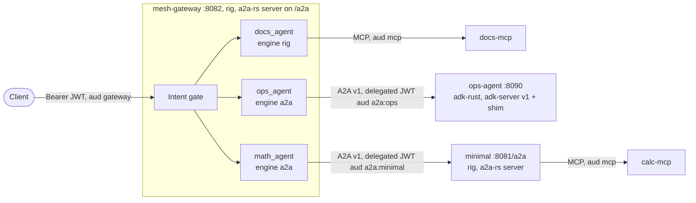

# A2A mesh

Three agents on three runtimes, called through one gateway over [A2A](https://a2a-protocol.org) v1.0. Platforms and the ADK agent share `PLATFORM_JWT_SECRET`, so the caller's identity travels with every hop (see ARCHITECTURE section 12).



| Piece | Where | Notes |
|---|---|---|
| `mesh-gateway` | `mesh-gateway/` (root workspace) | `docs_agent` (local, rig + MCP), `ops_agent` (`a2a:ops`), `math_agent` (`a2a:minimal`). Its own A2A server is on, so peers can call it. |
| `ops-agent` | `ops-agent/` (separate Cargo workspace) | adk-rust agent; skill `ops_triage`; runbooks `rb-consumer-lag`, `rb-disk-full`, `rb-broker-down`, `rb-dlq-growth`. |
| `minimal` | `examples/minimal` | built with `--features a2a`, started with `A2A_ENABLED=true`; its policy allows the mesh roles. |

Users (all in `mesh-gateway/config/users.yaml`): `alice-key` (reader), `bob-key` (engineer), `carol-key` (admin).

## Run natively

Needs Ollama with `gpt-oss` on `localhost:11434`.

```sh
make run-mesh-local          # generates PLATFORM_JWT_SECRET when unset; ops-agent has bearer auth on, audience a2a:ops
make eval-mesh               # in another shell
```

Or by hand:

```sh
TOKEN=$(curl -s localhost:8082/auth/token -d '{"api_key":"bob-key"}' -H 'content-type: application/json' | jq -r .access_token)
curl -s localhost:8082/v1/agents/run -H "authorization: Bearer $TOKEN" -H 'content-type: application/json' \
  -d '{"input":"Incident: consumer lag on the orders consumer group keeps growing"}' | jq .output
curl -s localhost:8082/.well-known/agent-card.json | jq '.skills[].id'
```

The first ops call can take a minute while Ollama loads the model; `remote_agents.*.timeout_secs` is 180.

## Run with docker compose

```sh
make up-mesh                 # docker compose -f examples/a2a-mesh/docker-compose.yml --env-file .env up --build -d
docker compose -f examples/a2a-mesh/docker-compose.yml --env-file .env --profile monitoring up -d prometheus   # optional
```

Ports are bound to `127.0.0.1`: gateway 8082, minimal 8081, ops-agent 8090. The MCP servers are internal. `ops-agent` builds from its own workspace (`WORKSPACE=examples/a2a-mesh/ops-agent`).

## What to look at

- `trace.engine` is `a2a` for ops and math answers, and `trace.usage` is the remote's usage when the remote is a platform (zero for the ADK agent, which reports none).
- Ask the mesh-gateway's A2A endpoint directly with any A2A v1 client: `POST /a2a` (JSON-RPC `SendMessage`, `SendStreamingMessage`, `GetTask`, `CancelTask`, `SubscribeToTask`; tasks are visible only to their creator), card at `/.well-known/agent-card.json`, skill ids `docs_agent`, `ops_agent`, `math_agent`, `auto`.
- `agentic_a2a_calls_total` and `agentic_a2a_call_duration_seconds` on `/metrics` count the outbound hops.
